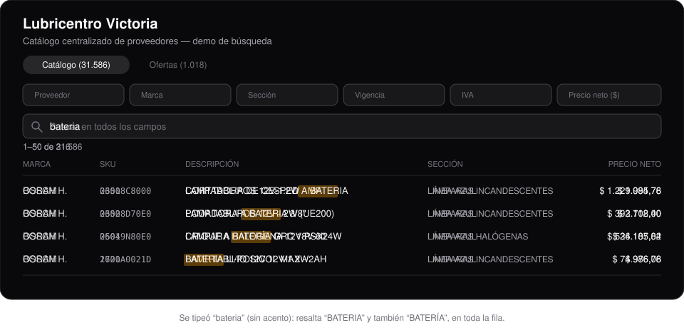

# Pantallas

| Ruta | Qué es | Endpoints principales |
|---|---|---|
| `/` | Catálogo y Ofertas, en pestañas. | `/api/productos*`, `/api/ofertas*` |
| `/cargas` | Subir un archivo de proveedor y ver el estado de las cargas. | `/api/uploads` |
| `/cargas/[id]` | Revisión de una carga antes de publicarla. | `/api/uploads/:id`, `/advertencias`, `/confirmar` |
| `/cargas/gestion` | Precio vigente por SKU y ofertas activas; cerrar o reactivar. | `/api/productos`, `/api/ofertas/cerrar\|reactivar` |
| `/cargas/auto-descargas` | ABM de las marcas que se descargan solas y «Probar ahora». | `/api/auto-descargas*` |
| `/stock` | Artículos, Movimientos y Reposición, en pestañas. | `/api/stock*` |
| `/ventas`, `/ventas/nueva` | Ventas y alta de venta. Desde acá se factura. | `/api/ventas*`, `/api/facturacion/comprobantes` |
| `/ventas/ya-facturada` | Registrar una venta que ya se facturó por otro medio. **Nunca va a ARCA.** | `/api/ventas/externas`, `/api/ventas/previsualizar` |
| `/clientes` | Receptores de facturas. | `/api/clientes*` |
| `/facturacion` | Comprobantes emitidos, con filtros. Admite `?ventaId=`. | `/api/facturacion/comprobantes` |
| `/facturacion/[id]` | Detalle, PDF, notas, reconciliación y estado del stock. | `/api/facturacion/comprobantes/:id*` (incl. `/stock`) |
| `/facturacion/config` | Datos fiscales del emisor y punto de venta. | `/api/facturacion/config` |

Las pantallas de facturación comparten `FacturacionNav` (Comprobantes, Ventas, Clientes y Datos fiscales) y el banner de estado de ARCA. Ver [facturacion.md](facturacion.md).

## Catálogo y Ofertas (`/`)

- **Búsqueda.** El buscador recorre **todas** las columnas, ignora los acentos y resalta las coincidencias.
- **Filtros por columna.** Hay de texto, combobox (Sección), rango (precios y descuentos), igualdad (IVA) y fecha («Válida hasta»). Se combinan con AND.
- **Orden y paginación.** Clic en la columna: ascendente, descendente y orden por defecto. 50, 100 o 200 filas por página.
- **Columnas.** Se pueden mostrar, ocultar, reordenar y redimensionar. Se recuerda por navegador.
- **Exportar.** Excel o CSV del resultado filtrado completo.
- **Selección:**
  - Editar: una fila abre el formulario completo; varias, la edición en lote de campos no identificadores;
  - Eliminar: borrado lógico.
- **Papelera.** «Ver eliminados» muestra solo las filas borradas, con la opción Restaurar.
- **Altas e imagen.** Alta manual («Nuevo producto» / «Nueva oferta») con un combobox de proveedor que crea el proveedor si no existe. La imagen por fila se sube al elegir el archivo.
- **Historial.** El botón ⟳ abre un modal con el gráfico y la tabla del precio de ese SKU (en ofertas, por tramo).
- **Detalle.** Las filas con `raw_data` se expanden para ver las columnas originales del proveedor.
- **Solo en Ofertas:**
  - estado Activa, Cerrada o Vencida;
  - «Ver cerradas/vencidas»;
  - «Marcar agotada» y «Reactivar». Cierran **todos los tramos** del SKU en esa oferta.

## Cargas (`/cargas`, `/cargas/[id]`)

- **Subida (`UploadForm.tsx`).** Recibe excel, PDF o imagen, con proveedor y tipo (Catálogo u Oferta). Para ofertas, el switch «Hasta agotar stock» manda `sinFechaLimite`.
- **Revisión (`ReviewTable.tsx` / `ReviewTableOfertas.tsx`).** Permite:
  - corregir el mapeo de columnas, con un select primario y otro secundario por columna para mapear a dos destinos;
  - editar cualquier valor;
  - ver advertencias ⚠ (solo informativas);
  - completar el IVA por defecto del proveedor y calcular el precio con IVA, el sugerido (con el % de ganancia) y el de lista con IVA.
- **Ninguna carga se publica sin «Confirmar carga».**

## Auto-descargas (`/cargas/auto-descargas`)

ABM con proveedor, marca, % de ganancia y un switch de activo. «Probar ahora» corre la fila en el momento. El resultado `carga_creada` o `publicado_automaticamente` lleva un link a la carga.

## Stock (`/stock`)

- **Artículos.** Tabla con filtros, papelera, alta, edición, movimiento (entrada, salida o ajuste) e historial.
- **Movimientos.** Historial de todos los artículos, con filtros.
- **Reposición.** Artículos en el mínimo o por debajo, con el proveedor más barato del catálogo.
